<p align="center">
  
</p>

<h1 align="center">traPYze</h1>

<p align="center">
  <b>Run your Python tools without the technical bits.</b><br>
  A friendly desktop for the scripts you, a colleague or an AI wrote:
  tiles, settings windows, schedules and a vault. No terminal needed.
</p>

<p align="center">
  <a href="https://github.com/kapistyn/trapyze/releases/latest"></a>
  <a href="https://github.com/kapistyn/trapyze/actions/workflows/tests.yml"></a>
  
  
  <a href="LICENSE"></a>
</p>

<p align="center">
  <a href="#install"><b>Install</b></a> ·
  <a href="#a-quick-tour">Tour</a> ·
  <a href="#make-your-own-tool">Make a tool</a> ·
  <a href="docs/guide.md">Full guide</a> ·
  <a href="#questions">Questions</a>
</p>

<p align="center">
  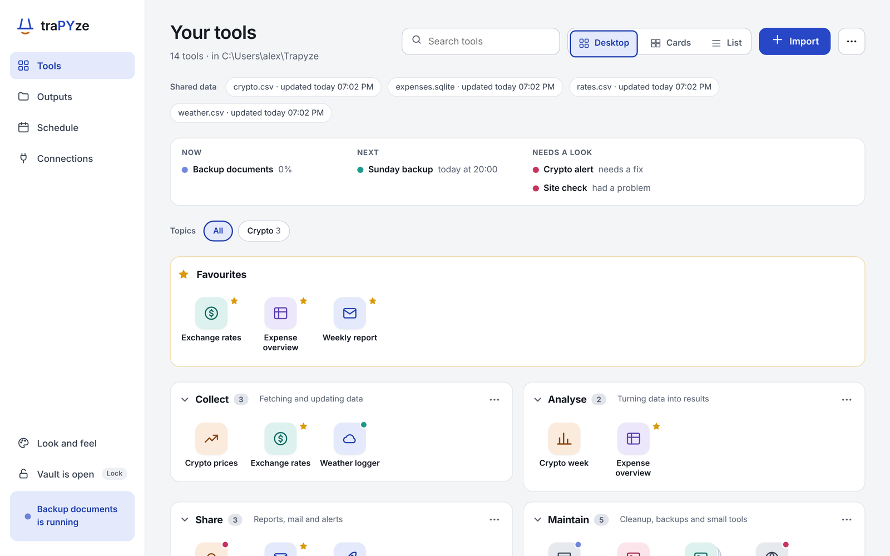
</p>

## Why traPYze?

Python is the easiest way to automate the boring parts of life: fetch prices, tidy
a folder, turn a bank export into a summary, mail yourself a report. AI chats
write such scripts in seconds. **Running them is the hard part:** a terminal,
packages that must be installed, settings changed inside the code, passwords
typed into the script, and scheduled runs that need cron or Task Scheduler.

traPYze takes all of that away.

| Without traPYze | With traPYze |
|---|---|
| Open a terminal, find the folder, type the command | Click a tile |
| Change values inside the code before each run | A settings window, made from the script's own label |
| `pip install` and broken environments | Each tool gets exactly the packages it needs, invisibly, pinned and tested |
| API keys and passwords typed into the script | A PIN-protected vault; tools get only the keys you allowed |
| Cron or Task Scheduler for daily runs | Plans like "every weekday at 07:30", also while you're logged out |
| Results scattered over folders | Every run with its files, settings and log, newest first |
| "What does this script do? Why did it fail?" | A health check, and Ask AI with any chat site |

**Who it's for:** anyone with a few useful scripts and no wish to babysit them:
hobbyists, analysts and traders, small businesses, teachers, researchers, and
everyone who got a script from ChatGPT, Copilot, Gemini or Claude.

<p align="center">
  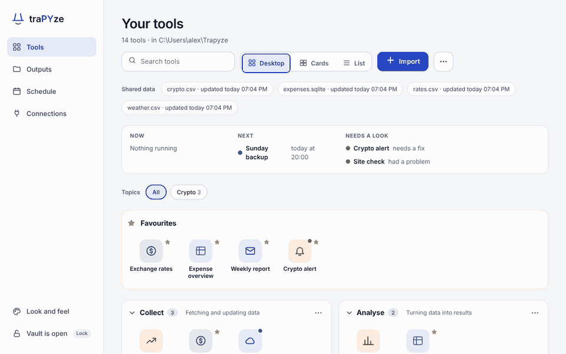
</p>

## Install

**Windows:** download **[traPYze-Setup.exe](https://github.com/kapistyn/trapyze/releases/latest/download/traPYze-Setup.exe)** and open it. Or paste this into PowerShell:

```powershell
irm https://github.com/kapistyn/trapyze/releases/latest/download/install.ps1 | iex
```

**macOS and Linux:** paste this into a terminal:

```sh
curl -LsSf https://github.com/kapistyn/trapyze/releases/latest/download/install.sh | sh
```

**Already use [uv](https://docs.astral.sh/uv/)?** traPYze is also [on PyPI](https://pypi.org/project/trapyze/):

```sh
uv tool install "trapyze[desktop]"
trapyze shortcut
```

You don't need Python: the installer adds [uv](https://docs.astral.sh/uv/), which
fetches and runs Python for traPYze. No administrator needed. traPYze opens when
it's done, with three example tools, and adds a shortcut to your desktop, Start
menu or Applications. It updates itself: when there's a new version, it says so
and installs it with one click.

## A quick tour

### Tools on shelves, sorted for you
Tools sit on shelves by what they do: **Collect**, **Analyse**, **Share**,
**Maintain** and **Apps**. traPYze sorts them itself from what each script does;
drag them anywhere you like after that. Star your daily tools, filter by topic,
and see at a glance what's running, what's next and what needs a look.
Prefer a table? Switch to the List view.

<p align="center">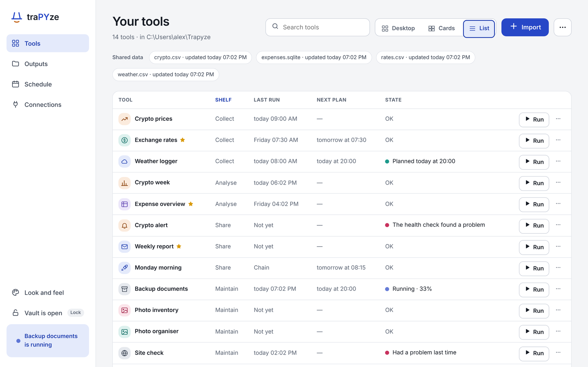</p>

### A settings window for every script, and live progress
The settings come from a few lines at the top of the script (its *label*), so
every tool explains itself. Press **Run** and keep working: traPYze shows the
progress and tells you when it's done.

<table>
<tr>
<td width="50%">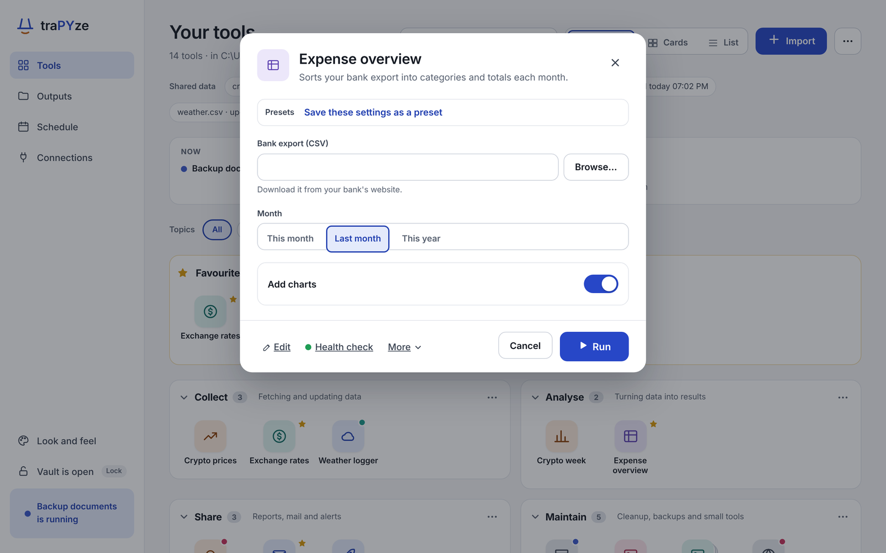</td>
<td width="50%">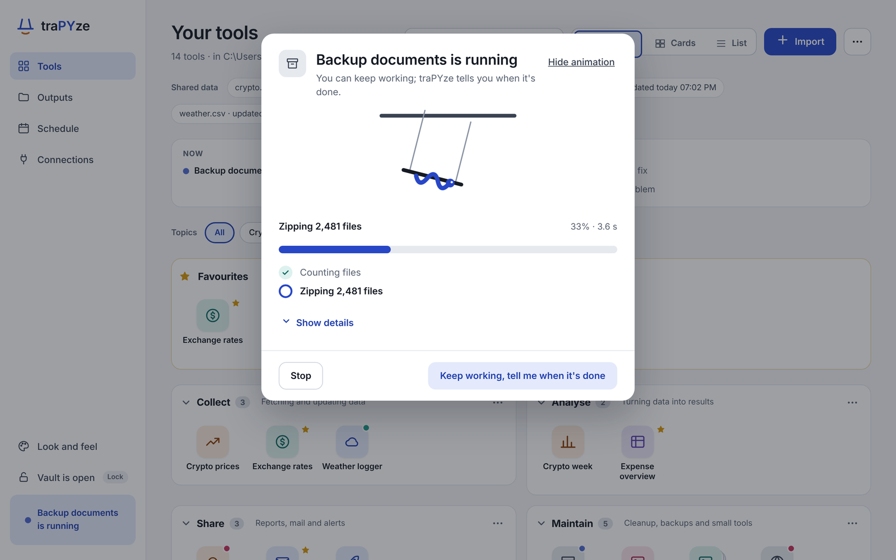</td>
</tr>
</table>

### Everything it made, in one place
Every run with its files, the settings it used and its log, newest first.
"Run again with these settings" is one click; a run that failed says why in
plain words. Runs you don't want can be removed from the list, one by one or all
failed ones at once; they wait 30 days in the bin.

<p align="center">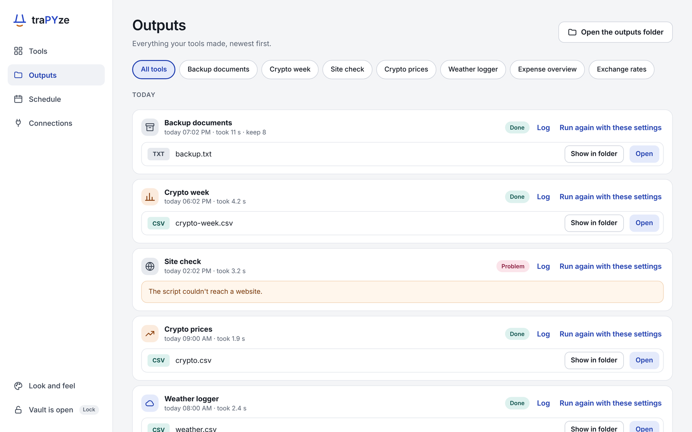</p>

### Plans that run by themselves, and a vault for your keys
"Every weekday at 07:30", "Sundays at 20:00". Plans use your computer's own
scheduler, so they run even when traPYze is closed; missed runs catch up.
Chain tools together: fetch, then analyse, then mail, with a step that waits for
your OK where you want one. A plan can try again after a failure. Keys and logins live
encrypted behind your PIN and only reach the tools you allowed.

<table>
<tr>
<td width="50%">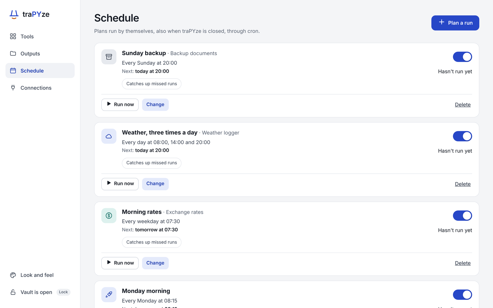</td>
<td width="50%">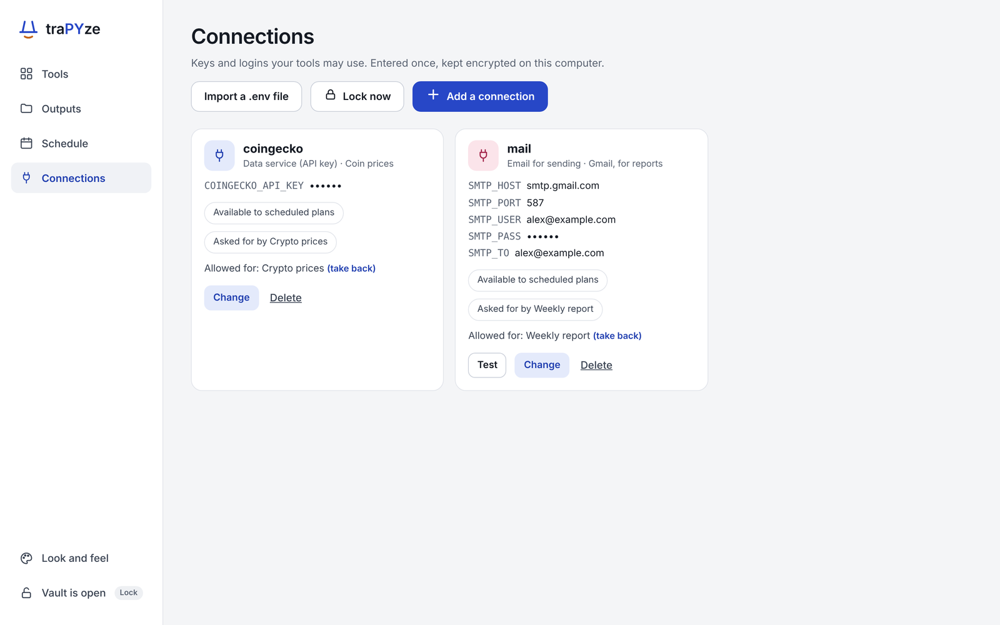</td>
</tr>
</table>

### Import anything, even a whole program
Point traPYze at a script, a folder, a .zip or a folder in WSL. It finds the
main script, turns its command-line options into settings, works out the
packages it needs, offers `.env` keys to the vault, and keeps the helper
scripts out of sight. Your original is never changed. A script you changed
elsewhere (with your AI, say) can be put back into its program with **Update
from a file or folder**, keeping its tile, settings and keys.

<p align="center">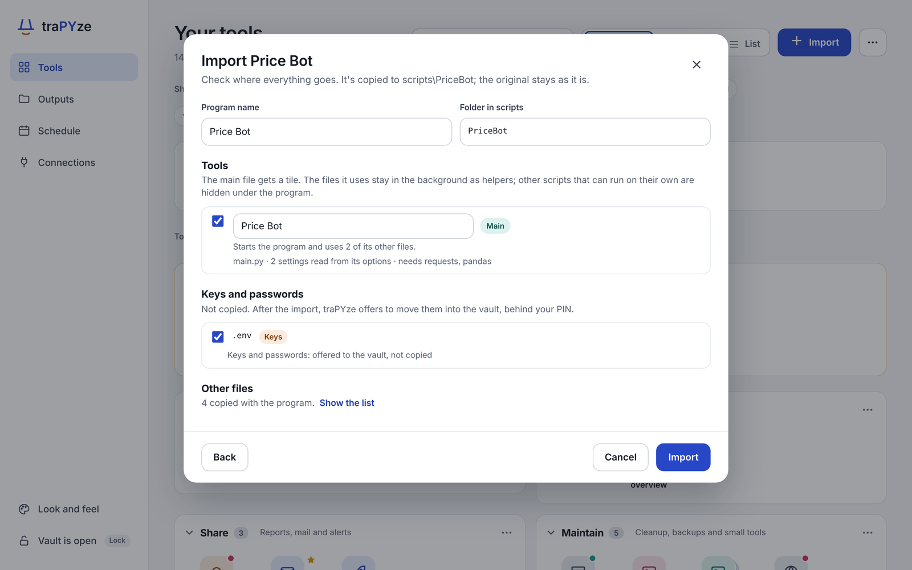</p>

### A health check, and AI help that shows its work
The health check reads a script offline: will it start, are packages missing,
is a key typed into the code, are there risky lines? **Ask AI** explains a
script, says why a run failed, or changes it, with a free chat site (Copilot,
Gemini, ChatGPT, Claude) or your own key. Secrets are masked first, and you see
every change before it's saved.

<table>
<tr>
<td width="50%">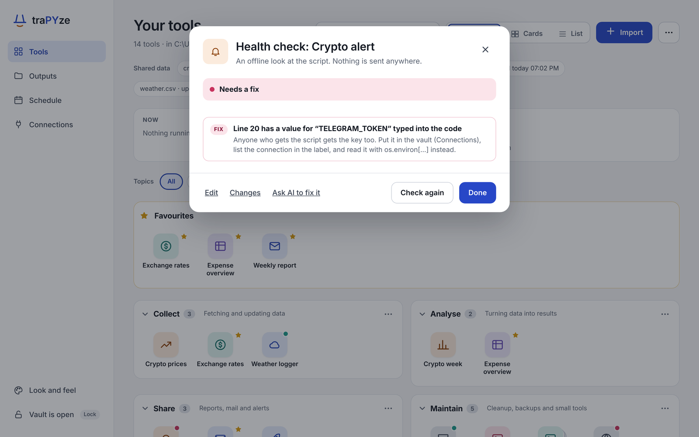</td>
<td width="50%">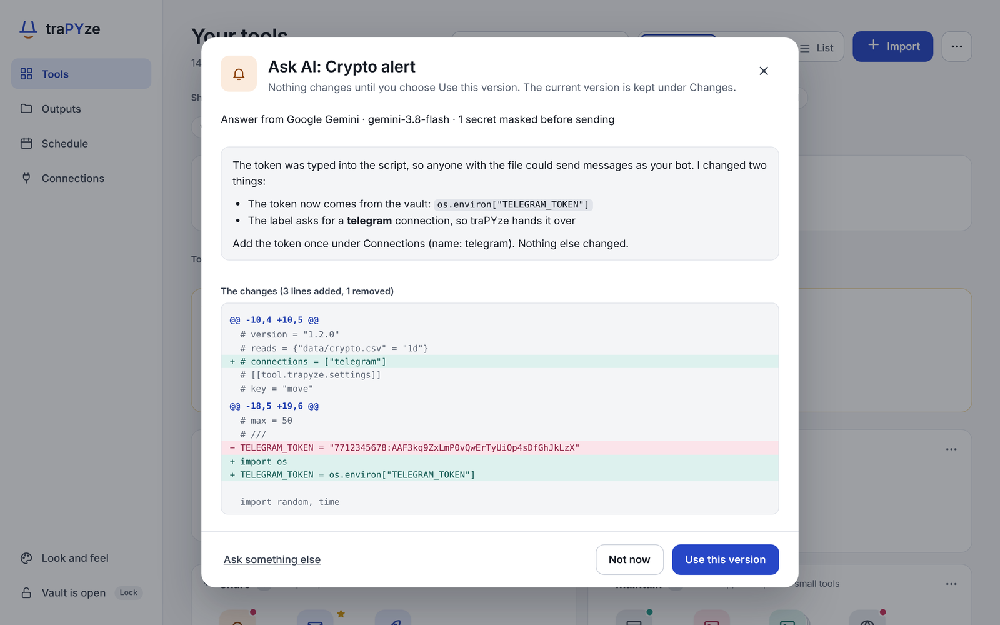</td>
</tr>
</table>

### Every change kept, and new tools in a minute
traPYze keeps a copy each time a script changes, whether by you, your editor or
an AI, and goes back with one click. **Edit** opens a script in VS Code,
PyCharm, Notepad++ or whichever editor you use. **New tool** gives you a small
working script to start from.

<table>
<tr>
<td width="50%">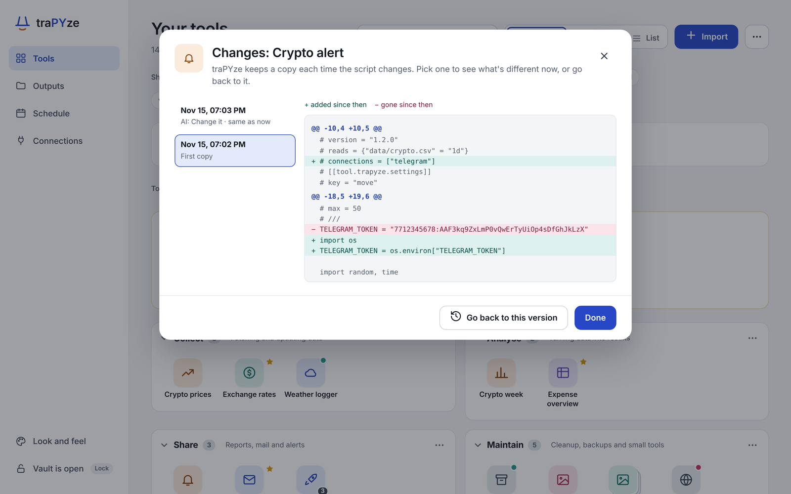</td>
<td width="50%">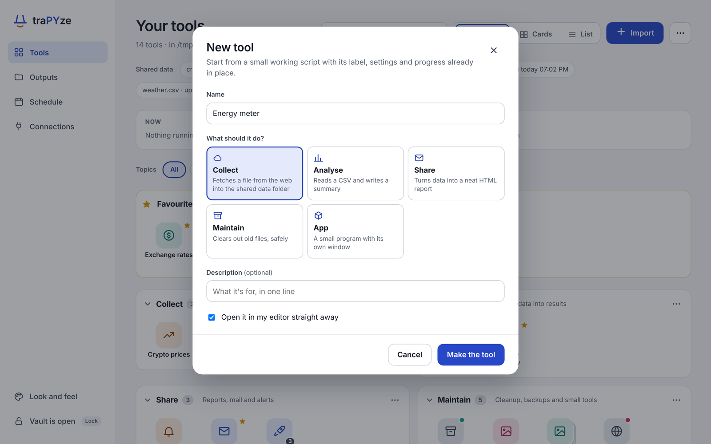</td>
</tr>
</table>

### Kept tidy, and backed up
Old results and run logs are put away by themselves (into a bin where they wait
30 days), and a Storage screen shows what takes room. All your tools share one
package library, so a package is installed once. **Back up scripts** keeps every
tool in a Git history and can send a copy to your own private repository: code
and notes only, never keys or data.

### Light or dark, your colours, its own window
Its own window with a tray icon (or your browser), light and dark themes,
accent colours, compact or comfortable, and your own icon per tool.

<p align="center">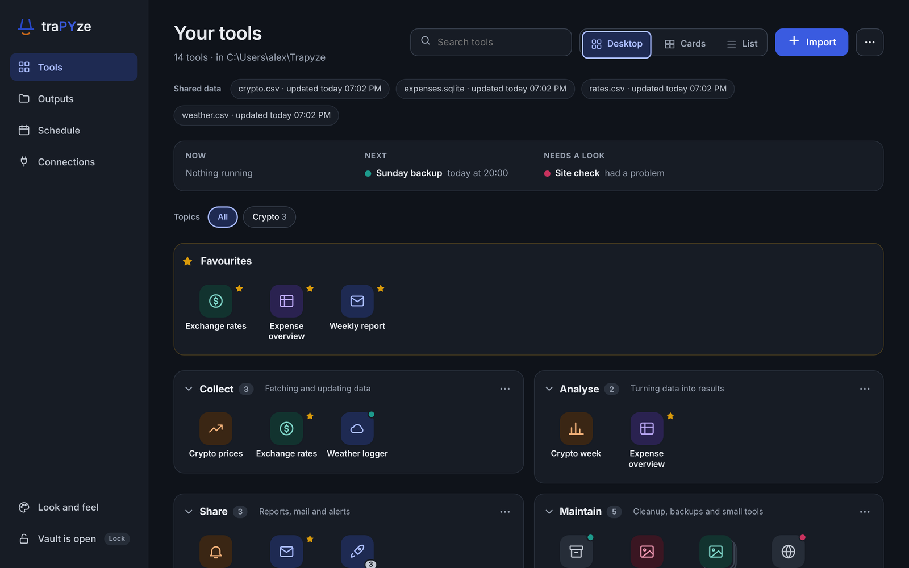</p>

## Ready-made tools

New to Python tools? **Get tools** adds packs that come with traPYze. They work
without the internet and need nothing installed:

| Pack | Tools |
|---|---|
| **Everyday files** | Tidy a folder · Find duplicate files · Set duplicates aside · Back up a folder · Restore a backup · Rename files · What takes the space? |
| **Home finance** | Bank statement overview by category and month · Find subscriptions |
| **Tables and data** | Check a download · Merge CSV files · CSV into a database · Database table to CSV |

Tools that change files show you a list first and never delete or overwrite your
files; your bank statement never leaves your computer.

## Make your own tool

Any Python script works. A few comment lines at the top make it a proper
traPYze tool with its own settings window:

```python
# /// script
# dependencies = ["requests"]
#
# [tool.trapyze]
# name = "Exchange rates"
# description = "Fetches today's euro exchange rates."
# icon = "coin"
#
# [[tool.trapyze.settings]]
# key = "currencies"
# label = "Currencies"
# type = "text"
# default = "USD, GBP, JPY"
# ///
import requests
import trapyze_helper as tz

s = tz.settings()                        # what the user chose in the window
tz.progress(0.5, "Asking the central bank")
...
tz.output_path("rates.csv").write_text(csv_text)   # shows up under Outputs
```

The top block is the standard [PEP 723](https://peps.python.org/pep-0723/)
format, so the script still runs anywhere else too. Don't want to write it
yourself? **New tool, Have an AI write it**: describe what you want, and traPYze
tells the AI how its tools work, so the script arrives ready. The same
[prompt](docs/guide.md#prompt-for-ai-written-tools) works in any AI chat, and
**Ask AI, Make it traPYze-ready** adds the label to a script you already have.

## How it works

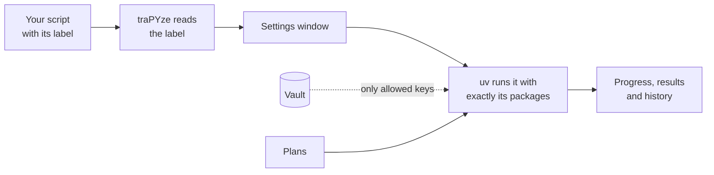

- **The engine is [uv](https://docs.astral.sh/uv/)**: each tool runs with its
  own packages, pinned per tool, so tools never break each other.
- **Everything stays on your computer.** traPYze listens only on 127.0.0.1
  with a fresh key per session. Nothing is sent anywhere unless a tool does
  so, or you use Ask AI; traPYze itself only looks for newer packages and a
  newer traPYze, once a day.
- **Your scripts stay yours**: plain .py files in your Trapyze folder,
  working with or without traPYze.

## Questions

**Is it free?** Yes, free and open source under the MIT licence, with no ads
and no tracking.

**Do I need to know Python?** No, to use tools. A little, to write your own,
and Ask AI helps with that.

**Is it safe?** traPYze keeps your keys encrypted and away from scripts that
weren't allowed to use them, and a tool you imported or an AI wrote shows what
it can do before its first run. But a tool is a program that can do anything you
can: only run tools from people you trust.
See [SECURITY.md](SECURITY.md).

**Does it work offline?** Yes. Only installing a tool's packages the first
time, tools that fetch data, Ask AI and the update check need the internet.

**Where are my things?** In the `Trapyze` folder in your home folder:
`scripts`, `outputs` and `data`. Back it up like any other folder.

**Can I run a tool from the terminal too?** Yes: `trapyze run "exchange rates"
--set currencies=USD`. See [the guide](docs/guide.md#from-the-terminal).

## Helping

traPYze is free and stays free. The best ways to help:

- ⭐ **Star the project** on GitHub, so more people find it
- [Report a problem or share an idea](https://github.com/kapistyn/trapyze/issues)
- Share a tool you made (see [CONTRIBUTING.md](CONTRIBUTING.md))

## Documentation

- **[The full guide](docs/guide.md)**: every screen and option, step by step
- [Changelog](CHANGELOG.md) · [Contributing](CONTRIBUTING.md) · [Security](SECURITY.md)

## Running the tests

```
uv run --with pytest --with pandas python -m pytest -q
```

No internet needed. See [CONTRIBUTING.md](CONTRIBUTING.md) for more.

## Licence

MIT, see LICENSE.
