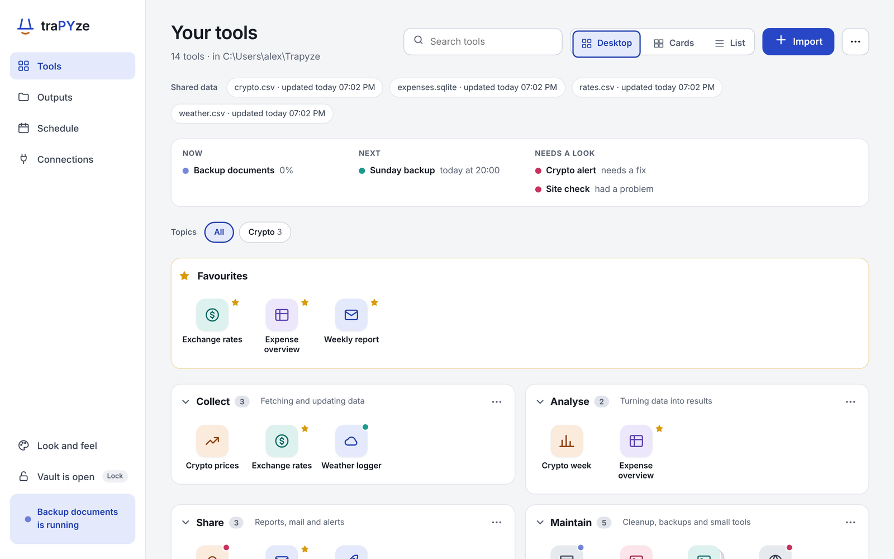
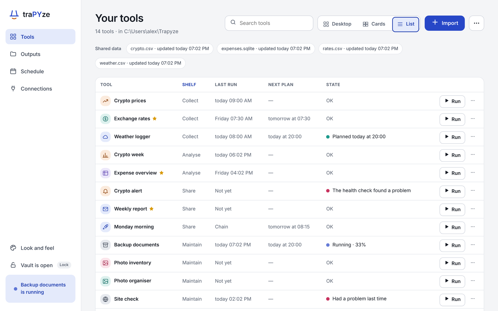
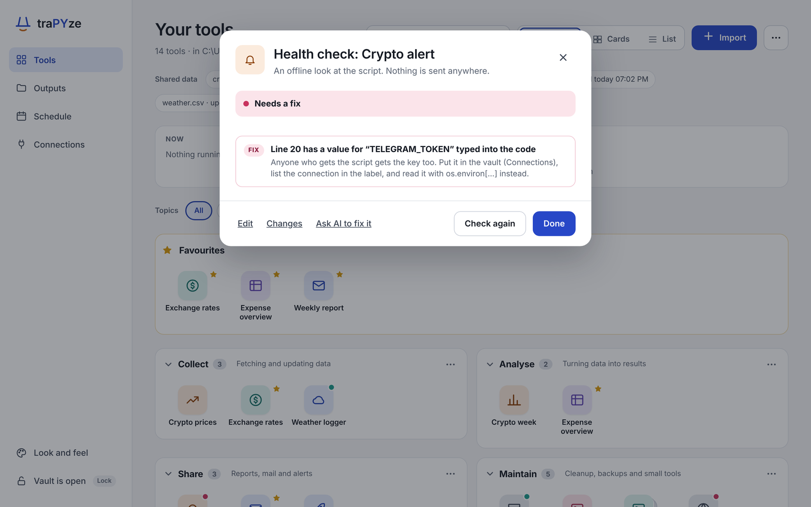
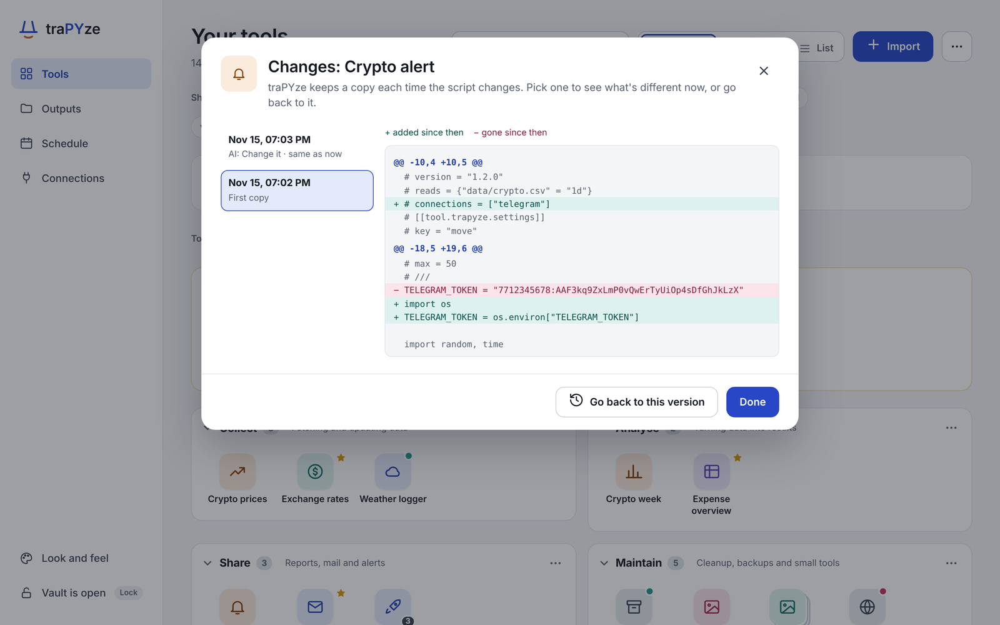
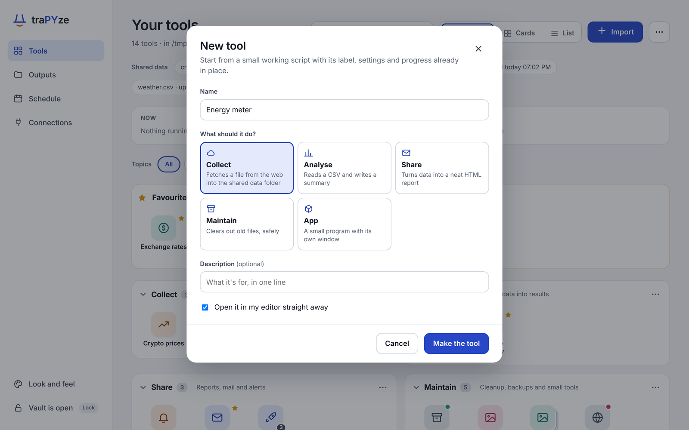
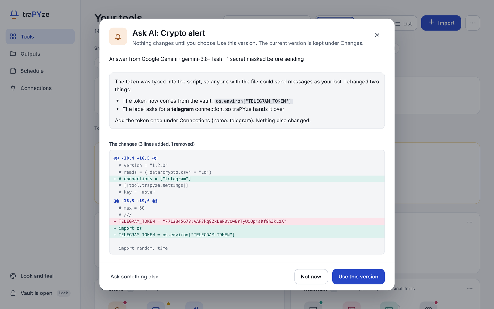
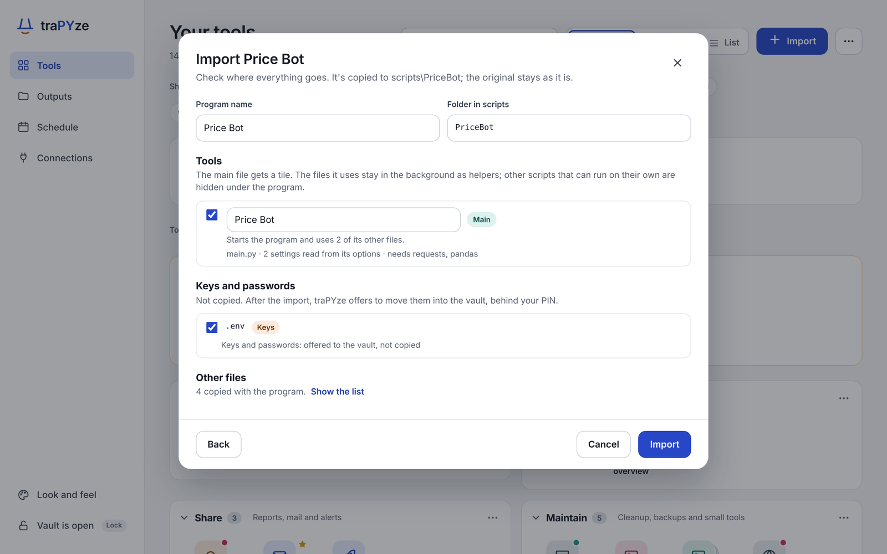
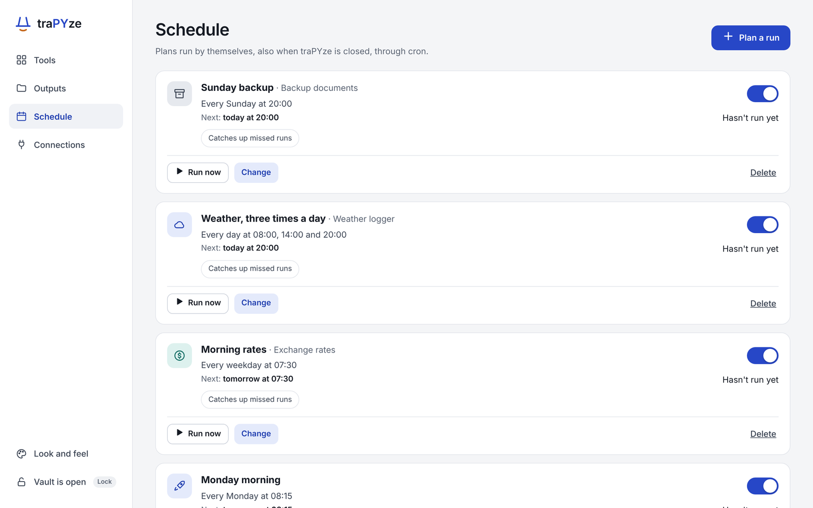
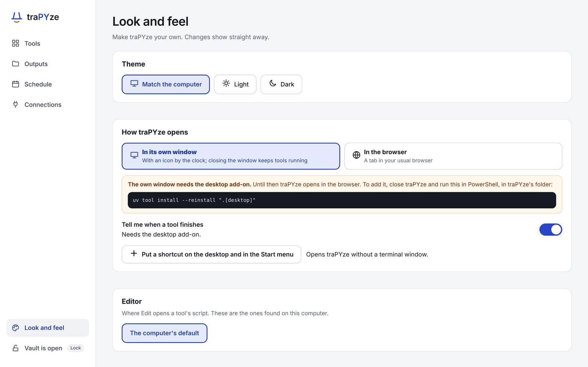
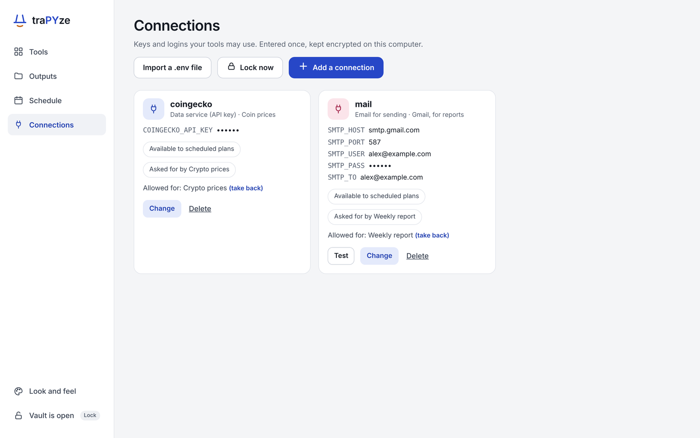

# The traPYze guide

Everything traPYze does, step by step. New here? Start with the [README](../README.md).

## Contents

- [Install, update, remove](#install-update-remove)
- [Open traPYze](#open-trapyze)
- [From the terminal](#from-the-terminal)
- [The home folder](#the-home-folder)
- [Making a script traPYze-ready](#making-a-script-trapyze-ready)
- [The Tools screen: a desktop with shelves](#the-tools-screen-a-desktop-with-shelves)
- [Making and changing tools](#making-and-changing-tools)
- [Ask AI](#ask-ai)
- [Ready-made tools](#ready-made-tools)
- [Importing a script or a whole program](#importing-a-script-or-a-whole-program)
- [Package versions: pinned, updated after a test](#package-versions-pinned-updated-after-a-test)
- [Sharing a tool](#sharing-a-tool)
- [Plans: runs by themselves](#plans-runs-by-themselves)
- [Its own window and the tray icon](#its-own-window-and-the-tray-icon)
- [Presets, chains and your own look](#presets-chains-and-your-own-look)
- [Keys and logins: the vault](#keys-and-logins-the-vault)
- [Web services: tz.api()](#web-services-tzapi)
- [Inside the script](#inside-the-script)
- [Prompt for AI-written tools](#prompt-for-ai-written-tools)
- [Before the first run](#before-the-first-run)
- [What's in it](#whats-in-it)

## Install, update, remove

**Windows:** download **traPYze-Setup.exe** from the
[newest release](https://github.com/kapistyn/trapyze/releases/latest) and open it,
or paste this into PowerShell:

```
irm https://github.com/kapistyn/trapyze/releases/latest/download/install.ps1 | iex
```

**macOS and Linux:** paste this into a terminal:

```
curl -LsSf https://github.com/kapistyn/trapyze/releases/latest/download/install.sh | sh
```

Both install [uv](https://docs.astral.sh/uv/) by Astral if it isn't there (it
fetches and runs Python for traPYze, so you don't need Python yourself), then
traPYze with its own window, add a shortcut and open it. No administrator
needed; everything stays inside your user account. Running the installer again
updates traPYze.

**Updates.** traPYze looks for a new version once a day and offers it on the
Tools screen; one click installs it and opens traPYze again. Switch the daily
look off under Look and feel, Updates, or update from a terminal with
`trapyze update`. Your tools, results, plans and vault are never touched.

**Removing.** Windows: Settings, Apps, traPYze (after the Setup), or run
`uninstall.ps1` from the release. macOS and Linux: run `uninstall.sh` from the
release. Your plans are taken out of the computer's scheduler; your traPYze
folder stays, so nothing you made is lost.

## Open traPYze



Use the **traPYze** shortcut (desktop and Start menu on Windows, Applications
on a Mac, the app menu on Linux), or type `trapyze open` in a terminal. The
first start creates your home folder with three example tools.

Started from a terminal with `trapyze open --browser`, traPYze opens in your
browser instead; keep that terminal open while you use it and press Ctrl+C
there to close traPYze.

The window only works on this computer: traPYze listens on 127.0.0.1, and
every address it opens carries a fresh key, so other web pages can't reach it.

## From the terminal

```
trapyze init                   # creates ~/Trapyze with three example tools
trapyze list
trapyze show "say hello"
trapyze run "say hello" --set name=Ada --set times=2
trapyze run "demo price data"  # fills a shared database with made-up prices
trapyze run "price report"     # reads that shared database, writes a CSV
trapyze history
trapyze version                # this version, and whether a newer one is out
trapyze update                 # install the newest version
```

Use `--home PATH` (or the `TRAPYZE_HOME` environment variable) to keep the
home folder somewhere else.

## The home folder

```
Trapyze/
  scripts/     one .py file per tool: the only code you see
  outputs/     results, as outputs/<tool>/<date_time>/
  data/        shared databases, used by every tool
  lib/         shared helper modules, importable by every tool
  .trapyze/    hidden: run history and logs, locks
```

Any `.py` file in `scripts/` is a tool, even without a label. A label adds a
name, a description and settings.

## Making a script traPYze-ready

Add one comment block at the top. `requires-python` and `dependencies` are the
standard [PEP 723](https://packaging.python.org/en/latest/specifications/inline-script-metadata/)
keys; the rest is traPYze's.

```python
# /// script
# requires-python = ">=3.11"
# dependencies = ["pandas"]
#
# [tool.trapyze]
# name = "Stock ranker"
# description = "Ranks shares on value and momentum."
# icon = "chart"
# color = "orange"
# version = "1.0.0"
# writes = ["data/prices.sqlite"]     # shared data this tool changes
#
# [[tool.trapyze.settings]]
# key = "top_n"
# label = "Number of shares"
# type = "int"                          # text, int, float, choice, bool, date, file, folder
# default = 25
# min = 5
# max = 100
# ///
```

Each setting can also have `options` (for `choice`), `help`, `required` and
`advanced`. For an existing script whose options are written differently
(for example `--smh-weight`), add `flag = "--smh-weight"` so the script keeps
its own option name. A setting with no default and no value is left out, so
the script's own default applies.

For scripts with several commands (`update`, `asof 2009-06-05`, …):

- `positional = true` passes the bare value, without a flag (a command, a date)
- `switch = true` on a bool passes just the flag when on (`--full`), nothing when off
- `only_for = { command = ["update", "prices"] }` uses a setting only when another
  setting has one of those values; otherwise it's left out and not checked
- arguments follow the order of the label, so options that must come before a
  command (like `--db`) stay in front

For shared data a tool reads, say how old it may be, and traPYze warns
before a run when it's older:

```python
# reads = { "data/prices.sqlite" = "1td" }
```

Ages: `30m`, `12h`, `2d`, `1w`, or `1td` for trading days (weekends don't
count, so Friday's prices are still fresh on Monday). When another tool
`writes` that file, the warning offers **Update with … first, then run**.
Market holidays aren't known, so after a holiday data may look one day old.

If a script ends with a special exit code to mean "done, but have a look"
(for example 2 when it raised alerts), add `warning_codes = [2]` under
`[tool.trapyze]`. traPYze then shows the run as finished with warnings
instead of failed.

In text, file and folder values, `{data}`, `{output}`, `{home}`, `{lib}` and
`{script_dir}` become the real folders, so `default = "{data}/prices.sqlite"`
keeps a script's database in the shared data folder.

## The Tools screen: a desktop with shelves



Tools show as small icons on **shelves**, grouped by what they do:

- **Collect**: fetching and updating data
- **Analyse**: turning data into results
- **Share**: reports, mail and alerts
- **Maintain**: cleanup, backups and small tools
- **Apps**: programs with their own window, such as games, small tkinter
  or Qt programs and Dash or Gradio dashboards. Clicking the tile starts it
  straight away; closing its window ends the run. (Streamlit apps need
  `streamlit run` and aren't supported yet.)

The first time, traPYze sorts every tool itself, from what its label and code
show. A tool that writes shared data goes to Collect, a tool that reads it
goes to Analyse, a tool with a mail connection goes to Share. Chains sit where
their last step sits. After that, you decide:

- drag a tile to another shelf, or use its ⋯ menu, "Move to shelf"
- rename, add, fold, reorder or remove shelves (⋯ next to a shelf name)
- star a tile (hover, ☆) to put it on **Favourites** at the top
- newly imported tools wait on **New** until you open one or drag it
  somewhere; then they go to the shelf traPYze suggests
- "Sort all tiles again for me" (⋯ next to Import) starts the sorting over

Hover a tile for its description and last run; ▶ runs it straight away with
last time's settings. A dot on the icon shows its state: blue is running,
orange means its data is old or it finished with warnings, red means a problem
last time, teal means it is planned today. A program shows as one stacked
icon; its ⋯ menu has its other scripts, its read-me and its folder.

The **Today** strip above the shelves shows what's running now, the next plan
and what needs a look (old data, a problem, a missed plan). Everything in it
can be clicked.

**Topics**: traPYze looks for recurring words in your tool names, such as AEX
or NDX100, and offers them as chips. Click one and only those tiles stay lit,
on every shelf. Hide the chips from the ⋯ menu if you don't use them.

**Views**: Desktop (shelves), Cards (large tiles with descriptions) or List (a
table with shelf, last run and next plan, sortable). Type in the search box
and press Enter to open the first match.

The arrangement is kept in `.trapyze/layout.json` in your home folder. Your
scripts are never changed.

## Ready-made tools

**Get tools** (top of the Tools screen) shows the packs that come with traPYze.
*Add* copies a pack into your scripts folder and puts its tools on the New shelf.
They work without the internet and use only what comes with Python.

**Everyday files**
- *Tidy a folder* sorts loose files into subfolders by kind (Pictures, Documents…)
  or by month. It first makes a list; switch on *Really move the files* when
  you're happy. A file is never overwritten: a second `photo.jpg` becomes
  `photo (2).jpg`.
- *Find duplicate files* compares contents, not names, and only makes a list.
- *Set duplicates aside* keeps one of each set (the one nearest the top of the
  folder) and moves the extra copies to a folder called "Duplicates set aside",
  in the same subfolders they came from. Nothing is deleted; you remove that
  folder yourself when you're sure.
- *Back up a folder* makes a dated zip in another place and keeps the newest few.
  A good one to plan weekly.
- *Restore a backup* checks that a backup zip is complete, and unpacks it into a
  new folder. Switch on *Only check the backup* to test a backup without
  unpacking it.
- *Rename files* gives tidy names (date first, numbered, or lowercase without
  spaces), again with a list first.
- *What takes the space?* lists the biggest files and subfolders.

**Home finance**
- *Bank statement overview*: download your transactions as CSV from your bank's
  website and choose that file. traPYze finds the date, amount and description
  columns itself (if it can't, name them under More options). You get
  `overview.html`, with totals per category and month. Categories come from
  keywords in `my-categories.csv` in the shared data folder; it's made the first
  time with common ones. Open it in Excel and add a line per shop, such as
  `bakery,Groceries`.
- *Find subscriptions* lists payments that come back weekly, monthly or yearly,
  and what each costs per year. It works best with a year of transactions.

**Tables and data**
- *Check a download* reports on a CSV file: rows, columns, the dates it covers,
  empty cells, identical rows and broken lines. It fails when the file is empty,
  is really a web page (a download that needed a login), or has fewer rows than
  you expect, so in a chain it stops the tools after it from using bad data.
- *Merge CSV files* joins all CSV files in a folder, also when their columns differ.
- *CSV into a database* puts a CSV into a table of a database in the shared data
  folder, where other tools can use it.
- *Database table to CSV* lists a database's tables, or saves one for Excel.

An added tool is an ordinary script: read it, change it (Changes keeps every
version), or delete its file. Adding a pack again only brings back files that are
missing; it never replaces one you changed.

## Making and changing tools



**Edit.** Every tool's settings window has **Edit** at the bottom, and every
tile has it in its ⋯ menu. It opens the script in your own editor: Visual
Studio Code, PyCharm, Cursor, Notepad++, Sublime Text, IDLE or Notepad (on a
Mac also BBEdit or TextEdit). traPYze finds the ones that are installed; pick
your favourite under Look and feel, Editor. Save in the editor and come back:
traPYze reads the label again, and a mistake shows as a plain message instead
of a broken tile. For an imported tool you edit traPYze's copy; the original
stays as it was.

**Changes.** traPYze keeps a copy of a script every time it changes (up to 40
per tool, in `.trapyze/versions/`). *More, Changes* lists them; pick one to
see, line by line, what's different now, and go back to it with one click.
Going back keeps the newer version too, so you can always return.



**Health check.** An offline review of the script, next to Edit, with a
green, orange or red dot. Nothing is sent anywhere. It looks for:

- things that stop it from starting: Python errors, and packages it imports
  but doesn't list (with an *Add* button that puts them in the label)
- keys and passwords typed into the code, which belong in the vault
- risky lines: `eval`, shell commands, deleting files or folders
- fixed paths like `C:\Users\…` that won't exist on another computer or
  for a plan
- settings in the label that the code never uses, packages listed but never
  imported, and a missing description

A tool with a red health check gets a red dot on its tile and shows up under
*Needs a look*.



**New tool.** *New tool* (below the shelves, or ⋯ next to Import) makes a small
working script to start from, with its label, settings and progress already in
place: Collect (download a file into the shared data folder), Analyse
(summarise a CSV), Share (an HTML report), Maintain (clear out old files,
safely) or App (a window made with tkinter). It lands on the right shelf and,
if you like, opens straight away in your editor.

## Ask AI



*Ask AI* (in a tool's ⋯ menu, under More in its settings window, on the card
of a run that failed, and in the health check) helps in four ways:

- **Explain it**: what the script does, step by step, in plain words
- **Why did it fail?**: reads the log of the last run that went wrong
- **Make it traPYze-ready**: adds the label, settings and progress to an
  imported script, without touching its calculations
- **Change it**: describe what should be different

Keys and passwords (vault values, and anything that looks like a key in the
script or log) are replaced by •••• before anything leaves the computer. A
changed script is shown as differences first; nothing is saved until you
choose *Use this version*, and the previous version stays under Changes.

Two ways to ask, set up under Look and feel, AI help:

- **Copy and paste (free, no setup).** traPYze copies the complete question
  and opens Microsoft Copilot, Google Gemini, Google AI Mode, ChatGPT or
  Claude. Paste it there, then paste the answer back into traPYze to see the
  changes.
- **Built in, with your own key**: Google Gemini (free key from Google AI
  Studio, with daily limits; Google may use free-tier requests to improve its
  products), OpenRouter (one key for many companies' models, including some
  free ones), Anthropic or OpenAI. traPYze checks the key, keeps it in the
  vault (as `ai-gemini` and so on), asks the service which models it has
  today and picks a sensible one; you can choose another.

## Importing a script or a whole program



On the Tools screen, **Import**. Choose a folder (a program with several
files) or a single script. A folder on WSL works too
(`\\wsl.localhost\Ubuntu\home\you\project`, or simply `/home/you/project`). traPYze reads everything and
shows where each file will go before anything is copied:

| In the folder | Where it goes |
|---|---|
| The main file (the one that starts the program) | A tool with a tile, with a label read from its own options (argparse: commands, options, on/off switches, choices, numbers) |
| Files the main file uses (also when they have their own test block) | Helpers: stay with the program, without a tile |
| Other scripts that can run on their own | Hidden under the program ("3 more scripts"); one click gives one its own tile |
| Data (`.sqlite`, `.db`, `.csv`, `.xlsx`, `.parquet`, …) | `Trapyze\data` (shared), or with the program, as you choose |
| `requirements.txt` / `pyproject.toml` | The packages in the tools' labels |
| `.env` | Not copied: offered to the vault afterwards |
| Notes and read-me files | With the program, one click away on the Tools screen |
| Backups, logs, `.venv`, caches, `run_daily.bat` | Left out (a plan does what `run_daily` did) |

- traPYze finds the main file itself: the one that reaches most of the
  program (through its imports, also inside functions, and scripts it starts
  itself), with a preference for names like `main`, `run`, `app` or the
  folder's own name. You can tick other scripts in the wizard to give them a
  tile anyway.
- Programs imported before this worked like that have a **Tidy up** link on
  their heading: it keeps the main file's tile and hides the rest. Nothing is
  deleted. In a script's settings window, **Hide the tile** / **Give it a
  tile** switches one at a time.
- A program goes into its own folder, `scripts\<program>\`, keeping its own
  layout, so its files still find each other. Its tools show as a group on
  the Tools screen. Single scripts stay loose in `scripts`.
- Where the code looks for a data file next to itself, the wizard shows the
  line and the change to the shared data folder; you tick which to make.
  The changed code still works outside traPYze.
- Data already in `Trapyze\data` is kept unless you choose otherwise (then
  the old one is kept as a copy). A tool that replaces an older single
  script with the same name keeps that script's hand-made label; the old file
  goes to `scripts\_replaced`.
- Programs that change a shared database get `writes` in their label, so two
  runs never change it at once. Add `reads` to the tools that only read it.
- Your original folder is never changed.
- Folders in `scripts` starting with `_` or `.` are ignored: a safe place for
  old versions.

## Package versions: pinned, updated after a test

A tool's extra packages (pandas, yfinance, …) are installed by uv. In a
tool's settings window, **Packages** shows them. **Pin the versions** writes
`<script>.py.lock` next to the script, and from then on the tool uses exactly
those versions every time.

- Once a day (while traPYze is open) it looks for newer versions, on a copy:
  nothing changes. Tools with newer versions show a notice on the Tools
  screen.
- **Update (tested first)** installs the new versions in a scratch folder and
  loads the tool's packages there (the tool itself doesn't run, so no data is
  touched). Only if that works does the tool switch over. A broken release
  stays out.
- **Go back to the previous versions** undoes the last change; traPYze keeps
  the last eight.

## Sharing a tool

In a tool's settings window, **Share** makes one file in `Outputs\Shared`:
a single script as a `.py` (with its presets in its label), a program as a
`.zip` (with its presets, its pinned versions and, if you tick it, the shared
data its tools use). The other person opens it with **Import**.

Never in it: the vault, `.env` files, results or run history. Every file is
checked for values from your vault first; if one turns up, nothing is shared
and traPYze says where it is. (Unlock the vault before sharing, so it can
compare with your real keys.)

## Plans: runs by themselves



Under **Schedule**, *Plan a run*: choose a tool (with its last settings, the
standard ones or a preset) or a chain, and when:

- **On days**: for example every weekday at 07:30 (several times a day is fine)
- **Repeatedly**: for example every 15 minutes from 09:00 to 17:30 on weekdays
- **Monthly**: a day from 1 to 28, or the last day of the month
- **Once**: a date and a time

The screen says it back in a sentence, with the next three times.

Plans run while traPYze is closed. traPYze hands them to the computer's own
scheduler, which starts `trapyze fire <plan>` at the right time:

| | Windows (Task Scheduler) | Linux (cron) | macOS (launchd) |
|---|---|---|---|
| Runs while traPYze is closed | yes | yes | yes |
| Wakes the computer | yes, from sleep, and from hibernation on most PCs | no | no |
| Runs while you're logged out | yes, if you give your Windows password once (Windows keeps it, not traPYze) | yes | no |
| Catches up after the computer was off | yes, or skips, as you choose | while traPYze is open | yes |

- Waking needs Windows' power option *Allow wake timers* (under Sleep in
  the advanced power settings). Plugged in is safest. Some laptops with
  "modern standby" wake only partly; check the plan's history the first
  days.
- Each planned time runs only once, even when both the background task and
  the open traPYze notice it. When traPYze is open, the run shows there
  live, with a notification when it's done.
- Plans that use connections need them marked *available to scheduled
  plans*, and permission is asked when you save the plan.
- Every plan keeps a short history (done, problem, missed) with the reason.
- If you change your Windows password, open plans that run while logged out
  and save them again.
- From a terminal: `trapyze schedule` lists plans, `trapyze schedule sync`
  hands them to the computer's scheduler again, and `trapyze fire <plan> --now`
  runs one right away.

## Its own window and the tray icon

With the desktop add-on, traPYze opens in its own window instead of a
browser tab, with an icon by the clock (the "tray"):

```powershell
uv tool install --reinstall ".[desktop]"
trapyze shortcut
```

The first line adds two open-source packages: pywebview (the window, using
Windows' built-in WebView2) and pystray (the icon). The second puts a
**traPYze** shortcut on the desktop and in the Start menu that opens it
without a terminal window.

- Closing the window keeps traPYze running in the tray, so tools carry on.
  Click the icon to bring the window back; right-click it for the outputs
  folder or **Quit traPYze** (which stops anything still running).
- When a tool or chain finishes while the window is hidden, a notification
  says so. Turn that off under Look and feel.
- Opening traPYze a second time brings the open one forward.
- After an update, opening traPYze closes the older copy that was still
  running in the tray (when no tools are running in it) and starts the new
  one. If tools are still running, it says so; quit from the tray when
  they're done.
- Prefer the browser? Look and feel, then *How traPYze opens*. From a
  terminal: `trapyze open --browser` or `trapyze open --window`.
- Without the add-on everything works as before, in the browser.
- When started from the shortcut, messages go to `.trapyze/app.log`.

## Presets, chains and your own look



- **Presets**: in a tool's settings window, *Save these settings as a
  preset* (for example "DAX, top 25"). Click a preset to fill everything in.
  From the terminal: `trapyze run "stock ranker" --preset "DAX, top 25"`.
- **Chains**: under Tools, *New chain*. Pick the tools in order, and for each
  one the settings used last time, the standard settings or a preset. Choose
  whether the chain stops or carries on after a problem. A chain waits its
  turn when another run is using the same shared data. From the terminal:
  `trapyze chain list` and `trapyze chain run "Morning routine"`.
- **Look and feel**: light, dark or matching the computer; six accent
  colours; roomy or compact tiles; confetti on or off. Per tool: an icon, a
  colour or your own picture (PNG, JPG or WebP, up to 300 KB). This is kept
  in traPYze's own folder; the scripts don't change.

## Keys and logins: the vault



Never put an API key or password in a script. Add it once under
**Connections** in the window: traPYze keeps it encrypted (AES-256) on this
computer behind a PIN or passphrase you choose. A tool asks for a connection
by name in its label:

```python
# [tool.trapyze]
# connections = ["fmp", "gmail"]
```

When the tool runs, each connection's values arrive as ordinary environment
variables (for example `FMP_API_KEY`, or `SMTP_HOST` … `SMTP_PASS` for an
email connection), so the script reads them with `os.environ["FMP_API_KEY"]`.

- The first time a tool asks for a connection, traPYze asks you to allow it.
  You can take that back on the Connections screen.
- Secret values are replaced by `••••••` in the progress window, the log and
  the run record, even if a script prints them.
- The vault locks itself after 30 minutes without use, or when you press Lock.
- Already have a `.env` file? Use **Import a .env file**; traPYze guesses which
  values are secret and lets you check before saving.
- Connections marked "available to scheduled plans" can be used while you're
  away (for the scheduler, coming in phase 6). Leave it off for anything you
  want to approve in person.
- Forgot your PIN? It can't be recovered: **Reset** empties the vault and you
  enter the connections again.

From the terminal, `trapyze run` asks for the PIN when a tool needs the vault.

## Keys that run out

Some services give keys that stop working after a while (HF Data Library: every
30 days). Fill in **The key runs out every … days** on the connection, and from
5 days before, the card, the home screen and a notification remind you. Paste the
new key with **Change** on the card; the count starts again from that day.

## Web services: tz.api()

For a data service such as Financial Modeling Prep, turn on **Use with
tz.api()** when you add the connection. Pick the service (FMP, Alpha Vantage, Twelve Data, Finnhub, EODHD, Massive/Polygon, Tiingo, HF Data
Library, GitHub, or another one; typing one of those as the connection's name picks it for you) and traPYze fills
in its address, where the key goes and the free plan's limits. Change the
limits if you're on a paid plan. Then, in a tool:

```python
import trapyze_helper as tz

r = tz.api("fmp", "quote", params={"symbol": "AAPL"})
print(r.json())
```

- traPYze adds the key; the script never needs to touch it.
- All tools together stay under the service's limit per minute: when the
  minute is full, a tool waits (the progress window says so) instead of
  getting refused. When the daily allowance is used up, the tool stops with
  a plain message (`tz.ApiLimitReached`).
- Answers are kept for the number of minutes you choose, so asking the same
  thing twice costs one call. `cache=False` asks the service again;
  `cache=5` keeps it for five minutes this time.
- "Too many requests" answers are retried after a short pause.
- The key is only ever sent to the service's own web address.
- The Connections screen shows today's calls, answers from the cache and
  problems per service, with a **Test** button and **Clear saved answers**.
  `trapyze usage` shows the same in a terminal.

Other options: `method="POST"`, `json=…`, `data=…`, `headers=…`, `timeout=…`,
and `cost=` for services that charge some requests more than one credit. The
answer has `.json()`, `.text`, `.content`, `.status` and `.from_cache`.

Only calls made through `tz.api()` are counted. A tool that calls a service
in its own way (for example with `yfinance`) still works, but outside the
shared limits.

The `cryptography` package is the one thing traPYze installs alongside
itself, so the first install needs an internet connection.

## Inside the script

Use the helper (optional, but it makes the most of traPYze):

```python
import trapyze_helper as tz

s = tz.settings()                        # chosen values, already checked
tz.progress(0.4, "Downloading prices")   # moves the progress bar
out = tz.output_path("ranking.xlsx")     # shows up on the result card
db = tz.data_path("prices.sqlite")       # shared data folder
```

Without the helper, a script still gets its settings as normal command-line
arguments (`--top_n 25`), and anything it saves with a relative path lands in
its output folder.

## Prompt for AI-written tools

An AI chat doesn't know traPYze. Without help it writes a plain script that asks
questions in a terminal; with the prompt below it writes a tool with its label,
settings and progress in place.

**The easy way:** *New tool*, then **Have an AI write it**. Describe the tool in a
sentence or two. traPYze copies the prompt with your description and opens your
chat site (or asks the built-in AI, if you set up a key). Paste the answer back:
traPYze checks the script, shows what it wants to do, and puts it on the New shelf.

**By hand:** paste this into any AI chat, followed by what you want the tool to do.
*New tool* also has a **Copy the prompt** button for it.

<!-- prompt:start -->
````text
You help someone who is not a programmer with a Python script that runs in traPYze, a desktop
launcher for Python tools. Answer in plain, friendly English; explain any technical word you use.

How a traPYze tool works:
- The file starts with a PEP 723 block (`# /// script` … `# ///`) listing `requires-python` and all
  `dependencies`, plus a `[tool.trapyze]` section with `name`, `description`, `version`, and one
  `[[tool.trapyze.settings]]` entry per option the user may change (`key`, `label`, `type` = text, int,
  float, bool, choice, date, file or folder, `default`, and `min`/`max`/`options` where they apply).
- In the code: `import trapyze_helper as tz`; read options with `tz.settings()`; report progress with
  `tz.progress(fraction, "what it's doing in plain words")`; save results with `tz.output_path(name)`;
  shared data files go in `tz.data_path(name)` and are listed as `writes = [...]` in the label.
- Never use `input()`. Never hard-code paths or keys. Keys come from the vault: list the connection
  name under `connections = [...]` in the label and read it from `os.environ`, or call a web service
  with `tz.api(name, path, params={...})`, which adds the key.
- Values shown as •••• were masked by traPYze because they are secret. Never invent them; read them
  from the environment instead.

Write a new tool as ONE Python file. First say in two or three sentences what it does and what the
user must set up (for example a key under Connections), then give the COMPLETE script in one
```python block. Use only packages that are really needed and list every one under `dependencies`.
Put a clear `name` and `description` in the label, and choose an `icon` (one of: chart, table, mail,
cloud, coin, trend, archive, bell, globe, photo, gauge, target, rocket, heart, cube, database) and a
`color` (one of: blue, teal, purple, orange, rose, slate).

The tool I want:
````
<!-- prompt:end -->

A tool an AI wrote, like a tool you imported, waits for one look before its first
run; see [Before the first run](#before-the-first-run).

## Before the first run

A tool is a program: it can do anything you can do on your computer, and traPYze
has no sandbox around it. So a tool you **imported** or that **an AI wrote** doesn't
run straight away. The first time you press Run, traPYze shows:

- where it came from
- what it wants to do: use the internet, use keys from your vault, delete files,
  start other programs, use a fixed folder outside traPYze, change shared data
- what the health check found

Choose **I've looked, run it** and it runs like any other tool from then on. Until
then it can't be planned or run in a chain either. Tools you make from a template or
write yourself in the scripts folder never ask.

Only run tools from people you trust. When in doubt: *Ask AI, Explain it*.

## What's in it

Done and tested:

- Ask AI: explain, why it failed, make it traPYze-ready and change it, by
  copy and paste with any chat site or built in with a Gemini, OpenRouter,
  Anthropic or OpenAI key; secrets masked, changes shown before saving
- making and changing tools: Edit in your own editor, a copy of every change
  with going back, an offline health check with fixes, and new tools from
  five templates; an Apps shelf for programs with their own window
- the Tools desktop: shelves sorted by what tools do, drag and drop,
  favourites, a New shelf for imports, topic chips, a Today strip, quick
  run, and Desktop, Cards and List views
- the window: tool tiles, a settings window built from each label (with
  "More options" for advanced settings and only the options that apply to the
  chosen command), live progress with Stop, and a result card for done,
  done with warnings, stopped and failed
- Outputs: every run with its files, settings and log, and "Run again with
  these settings"; traPYze remembers the settings you used last per tool
- label reader with plain-English errors, for labels and for settings
- background runner with live progress, cancel, full log and run record
- shared-data locks, so two tools never write the same database at once
- plain-English explanations for common failures
- the vault: PIN-protected connections, per-tool permission, masking of
  secrets in all output, auto-lock, `.env` import, a test button for email
- the API gateway: `tz.api()` with shared limits across tools, a cache,
  retries, usage per service and presets for six data services
- presets, chains (also from the terminal), data-freshness and disk checks
  before a run, and Look and feel with a dark theme and per-tool looks
- its own window with a tray icon, notifications and shortcuts (the
  desktop add-on), with the browser as the fallback
- the import wizard for single scripts and program folders, with program
  groups on the Tools screen, also from WSL and from shared .zip files
- package versions pinned per tool, a daily look for newer ones, updates
  tested before they're used, and going back with one click
- sharing a tool as one .py or .zip, checked for vault values
- plans that run by themselves through Task Scheduler (Windows), cron
  (Linux) or launchd (macOS), waking the computer and running while logged
  out on Windows
- tested natively on Windows with three real tools

- installers for Windows (Setup.exe or one PowerShell line), macOS and Linux,
  and updates of traPYze itself from its GitHub releases

Next: the traPYze store, a gallery of ready-made tools checked automatically.

